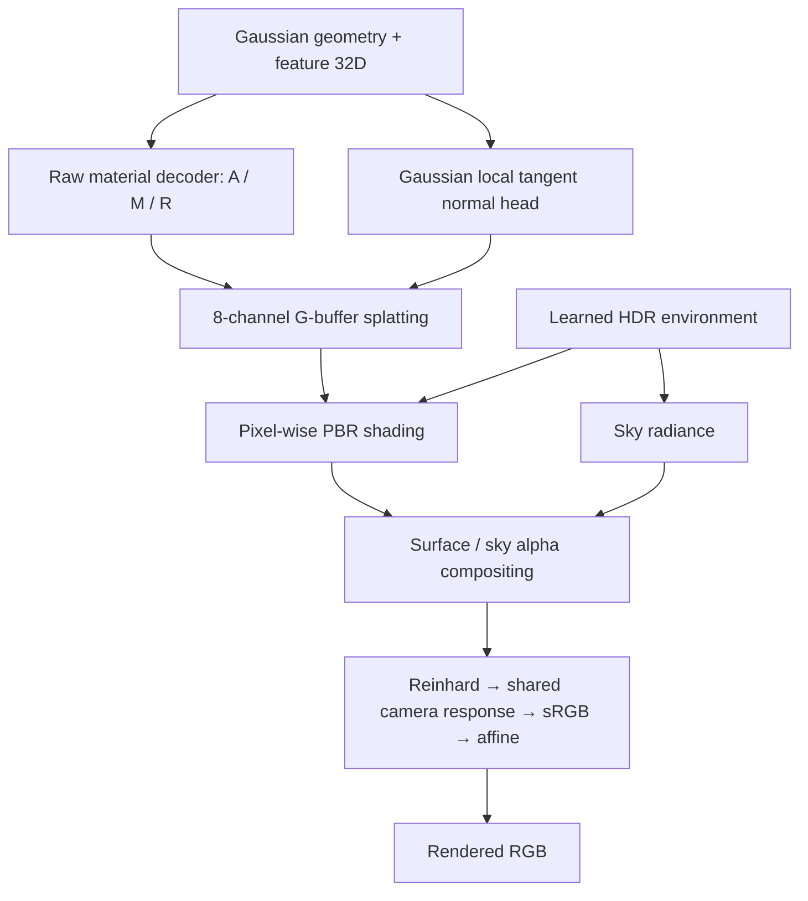

# 3ableGS에서 WeatherCity Base v4 재구현 계획

작성일: 2026-10-16. 갱신일: 2026-10-17. 상태: **788/30프레임 Base v3/v4 학습·평가 완료. Rain/Snow 코드·짧은 실제 장면 검증 완료, 3단계 본학습 대기**.

목표는 삭제된 디스크를 복구하는 것이 아니라, 남아 있는 Codex 대화의 코드·설정·평가 기록을 근거로 `/home/user/Desktop/3ableGS`에 Base v4를 재구현하는 것이다. 최초 계획 작성 후, 사용자의 1단계 실행 요청에 따라 아래 실행 기반을 구현·검증했다.

**복원 기준은 `Base v4 = Base v3 + combo_perceptual_02`이다.** 사용자가 직접 정의한 기록 [E01](evidence/E01_definition.txt), 다시 확인한 기록 [E02](evidence/E02_reaffirmation.txt), 당시 실제 YAML [E03](evidence/E03_combo_overlay.txt)이 일치한다. Rain/Snow material decoder는 이 raw 모델을 고정한 상태에서 별도로 학습한다. Base v4의 raw LPIPS loss를 weather 학습에 자동으로 추가하지 않는다.

## 진행 기록: A단계 완료

- [data_100f.yaml](../../configs/reconstruction/data_100f.yaml): camera 0, frame 000–099, stride 8, seed 0의 데이터 준비 설정. 모델·loss가 없는 준비용이며 Base v4 학습 설정을 대신하지 않는다.
- [config loader](../../utils/config.py): 상대 경로 base 상속, 순환 검사, dataset 기본값 < YAML < CLI 우선순위. `tools/train.py`에 연결하고 `--train_weathers` 생략 시 raw-only 선택이 되도록 수정했다.
- Raw-only 로더에서 rain 필수 조건을 제거하고 선택 mask의 초기화를 보완했다. `rigid.py`의 문법 오류도 수정했다.
- SMPL editable 패키지를 네트워크 없이 로컬 `3ableGS/third_party/smplx`로 다시 연결했다. 핵심 패키지 11개 import 및 실제 GPU gsplat 8-material+depth forward/backward·AbsGrad 검증을 통과했다. [환경 기록](../../logs/reconstruction/phase1_environment.json).
- 5개 씬의 paired RGB·mask header, calibration/ego pose, LiDAR 파일 크기, object annotation 참조, SMPL 파일 존재 검사를 통과했다. 씬마다 train88/test12. [데이터 목록](../../data/reconstruction/manifests/base_v4_inputs.json).
- Config/로더/manifest 테스트 **16개 통과**, 실제 094의 2프레임 raw-only 축소 CPU 로딩·ray 검증 통과. 전체 Python 구문 검사와 train CLI import/help도 확인했다.

점검 명령은 저장소 루트에서 다음과 같다. GPU 명령은 GPU가 보이는 일반 셸에서 실행한다.

```bash
.conda/bin/python tools/resolve_config.py --config_file configs/reconstruction/data_100f.yaml
.conda/bin/python tools/build_reconstruction_manifest.py --out data/reconstruction/manifests/base_v4_inputs.json
.conda/bin/python tools/check_reconstruction_environment.py --cuda-smoke
MPLCONFIGDIR="$PWD/.cache/matplotlib" .conda/bin/python -m unittest discover -s tests -v
```

이번 검사에는 모든 이미지의 전체 픽셀 decode, LiDAR 전체 point 값 검사, SMPL pickle 내용 검증, PBR shading 또는 실제 학습은 포함되지 않는다. 아래의 “현재 상태” 표는 최초 계획 당시 감사 결과이며 A단계 항목의 수정 여부는 이 진행 기록을 기준으로 한다.

B단계 추가 확인: 788 raw 30프레임의 명령 제공을 위해 과거 타일 준비·합성 도구 원문을 복원했다. [E17](evidence/E17_gbuffer_helpers.txt), [E18](evidence/E18_gbuffer_runner.txt)에서 아래 5절의 정확한 single-static 생성 설정을 확인했다. [실행기](../../tools/run_single_static_gbuffers.py)는 기본값이 preview이며 `--execute`를 명시해야 생성한다. 2026-10-17에 788 raw/rain/snow 각각 30프레임·120 PNG, 합계 360 PNG 생성이 완료됐다. 각 파일의 1920×1280 크기와 decode 무결성을 확인했다.

C·D단계 추가 확인: 788 raw30 Base v3의 30k 학습과 test 3장 평가를 완료했다. PSNR 30.251726 / SSIM 0.918945 / LPIPS 0.133204이며 학습 loop 시간은 1:26:48이다. 같은 조건의 Base v4도 30k 학습·평가를 완료했다. PSNR 30.124935 / SSIM 0.917821 / LPIPS 0.108272, 학습 loop 1:40:42로 LPIPS가 18.7% 낮아졌다. [D단계 상세 및 학습·평가 명령](phase4_base_v4.ko.md).

E단계 추가 확인: Rain/Snow material/environment/joint 코드, checkpoint 상속 설정, 단계별 optimizer, full-state 재개와 6단계 실행기를 복원했다. 회귀 테스트 102개 및 실제 788의 날씨별 3회 update(원본 해상도 joint 포함)를 통과했다. Frozen base state·Gaussian 수 유지, test8/16/24의 strength0 raw 복귀를 확인했다. [E단계 구성·검증·실행 명령](phase5_weather.ko.md). 실제 30k/3k/5k 학습과 최종 날씨 품질 평가는 아직 남아 있다.

## 1. 근거 범위와 판정 방법

로컬 `~/.codex/sessions` 및 `archived_sessions`의 기록 파일 712개를 검색했다. 키워드가 포함된 파일은 327개, 관련 사용자·assistant 메시지와 도구 기록을 색인한 파일은 268개다. Base v4 관련 40개, Base v3 관련 118개, PBR 관련 229개, 평가 관련 177개이며 서로 중복된다. 같은 대화의 분할·중복 파일도 있으므로 이를 독립 대화 수로 해석하지 않는다.

- [conversation_index.json](conversation_index.json): 관련 기록 파일과 주제별 줄 번호. 이번 계획 작업 이전 기록을 대상으로 한다.
- [artifact_mentions.json](artifact_mentions.json): 과거 모듈·설정·실행 도구 158개 경로의 언급 위치. 완전한 소스 복원을 뜻하지 않는다.
- [evidence_manifest.json](evidence_manifest.json): 핵심 발췌의 원본 JSONL 경로, 줄 번호, 시각, 증거 종류.
- [evidence](evidence/): 사용자 정의, 실제 설정·소스 출력, 과거 평가값, 구조 설명의 발췌.
- 남아 있는 [방법 설명 문서](/home/user/Desktop/WeatherCity_Method_Overview/README.md)와 [수식 설명](/home/user/Desktop/WeatherCity_Method_Overview/README_v2.md)도 교차 확인했다. 그림·teaser는 구조와 출처를 확인하는 자료이며, 학습 checkpoint나 정량 평가를 대신하지 않는다.

확정 우선순위는 **사용자의 명시적 정의 → 해당 실행의 resolved config·실제 코드·결과 JSON 출력 → 실행 명령 → assistant 설명**으로 둔다. 오래된 8D 모델, 임시 실험, 나중에 수정된 설명을 최종 32D Base v4에 합치지 않는다. 로컬에 저장되지 않은 대화, 읽을 수 없는 암호화된 압축 내용까지 확인했다는 의미는 아니다.

## 2. 현재 3ableGS 상태와 선행 작업

시작 코드는 공식 WeatherCity commit `0fc4615f9179481e839a4b9806b4822f99b7aa34`이다. 시작 당시 없던 Base v3 PBR 모듈은 2026-10-16에 복원했고, 아래 초기 상태 표의 C단계 항목을 구현·검증했다. [C단계 구현·검증 기록](phase3_integration_provenance.md)에 정확한 출처와 검증 범위를 기록했다. 2026-10-17에 Base v4 combo와 weather residual 구현·검증도 완료했다. 아래 표는 복원 시작 당시의 감사 기록이다.

| 확인 항목 | 현재 상태 | 구현 시 조치 |
|---|---|---|
| Gaussian decoder | `feature.py`의 weather별 RGB 3채널 MLP | PBR의 5채널 재질 decoder와 normal head를 명시적으로 분리 |
| 렌더 출력 | `models/trainers/base.py`가 RGB3 + depth1을 가정 | PBR 경로에 material8 + depth 계약 도입; 모든 node와 class별 render를 함께 연결 |
| raw-only 데이터 | `pixel_source.py`에 rain 필수 assert | raw만 불러오는 PBR 단계 허용 |
| 기본 데이터 설정 | 존재하지 않는 `/data/...`, 전체 프레임, test stride 0 | 로컬 경로·100프레임·stride 8을 확정 설정에 저장 |
| editable SMPL 패키지 | 기존 `WeatherCity/third_party/smplx` 경로 참조 | `3ableGS` 내부 경로로 다시 연결하고 import 위치 확인 |
| Python 문법 | `models/nodes/rigid.py`에 들여쓰기 오류 | 필요한 최소 수정. 현재 feature 경로에서 이 파일이 반드시 import되는 것은 아님 |
| resume | 공식 기본 구현은 optimizer 복구 미지원 | warm start와 optimizer 포함 resume를 분리 |
| weather 평가 로딩 | 평가 요청 weather만으로 모델을 만들어 strict-load | checkpoint의 전체 head를 먼저 만든 뒤 렌더 weather 선택 |
| shell launcher | `.gitignore`에서 `*.sh` 제외 | launcher를 명시적으로 추적하거나 Python 실행기로 작성 |

현재 환경에는 Torch 2.10.0+cu128, torchvision 0.25.0+cu128, gsplat 1.3.0, NumPy 1.26.4, nvdiffrast 0.4.0 등이 있다. 예전 requirements를 일괄 적용하기보다 import, CUDA rasterization, PBR backward를 검증하고 실제 사용 버전을 고정한다. A단계에서는 버전 변경 없이 로컬 SMPL editable 연결만 재설치했으며, PBR shading backward는 C단계에서 검증한다.

확인된 camera 0 이미지 수:

| 씬 | Raw | Rain | Snow | 복원 학습 범위 |
|---|---:|---:|---:|---|
| 023 | 199 | 100 | 100 | 000–099 |
| 094 | 198 | 100 | 100 | 000–099 |
| 114 | 198 | 150 | 150 | 000–099 |
| 172 | 198 | 100 | 100 | 000–099 |
| 788 | 199 | 100 | 100 | 000–099 |

과거 대화의 `113`과 `114`는 구분한다. 현재 확인된 데이터와 Base v4 과거 5개 씬 결과는 **114**이며, 113을 임의로 114로 바꾸지 않는다. VGG·SMPL 자산과 새로 생성한 788 raw/rain/snow 30프레임 G-buffer가 존재한다. 나머지 씬 및 100프레임 범위의 G-buffer는 준비해야 한다.

## 3. 먼저 복원할 Base v3의 구조

구조 근거는 [E08](evidence/E08_architecture.txt), 최종 실행 설정 근거는 [E05](evidence/E05_resolved_and_runner.txt), [E11](evidence/E11_config_tail.txt)이다. E08은 과거 설명이므로 세부 수식·초기화는 색인된 실제 패치와 대조한 뒤 구현한다.



| 구성 | 복원할 내용 |
|---|---|
| Gaussian feature | 32D. Background/Rigid/Deformable/SMPL 모두 호환 |
| Material 입력 | Background는 feature32 + detach한 정규화 xyz3, 나머지는 feature32 |
| Material decoder | Background `35→32→5`, 나머지 `32→32→5`, LeakyReLU `negative_slope=0.01`; A/M sigmoid, R=`0.99*sigmoid(logit)+0.01` |
| Normal | geometry normal에 Gaussian-local tangent 보정; `max_tangent=0.5`, regularization 0.01, 설정 seed 15015 |
| 동적 normal | Gaussian 회전과 object/deformation 변환을 적용해 shading 좌표계 일치 |
| Rasterization | `[A_r,A_g,A_b,M,R,N_x,N_y,N_z]` 8채널과 depth; alpha로 재질 정규화, normal 재정규화 후 픽셀 단위 shading |
| HDR / BRDF | 학습 HDR을 surface lighting과 sky가 공유. 과거 GGX prefilter·BRDF LUT·diffuse 구현 복원 |
| EnvLight 설정 | resolution 64, mips 5, BRDF LUT 64, GGX tail 16; LR 0.01→0.001, `opt_after=3000`, TV 0.001 |
| Camera response | Reinhard 뒤, sRGB 앞의 공유 단조 곡선. 9 knots, 최소 slope 0.05, (0,0)/(.5,.5)/(1,1) 고정, identity 초기화 |
| Response 학습 | LR 0.001, identity/smoothness regularization 각각 0.001. RGB·프레임·weather가 공유 |
| Camera / affine | CamPose LR 0. 기존 affine 유지: LR 1e-5, weight decay 1e-6, affine loss 0.001 |

geometry normal은 Gaussian 최소 scale 축에서 유도한다. 당시 소스에서 normal head `32→32→3`, 중간 ReLU, seed 15015, 마지막 층 weight/bias 0 초기화를 확인하고 복원했다. `b=0.5*d/sqrt(1+||d||²)`에서 최소 scale 축 성분을 빼고 최종 world quaternion으로 회전한 뒤 geometry normal에 더해 정규화하며, camera-facing flip은 마지막이다. [재질·normal 상세 근거](phase3_material_provenance.md).

SMPL은 최종 저장 설정의 `use_voxel_deformer=true`, `freeze_x=false`를 기준으로 한다. 이전 8D 실험의 `false/true` 설정이나 affine 제거 실험을 가져오지 않는다. 기존 clone/split/cull 시 feature 및 optimizer state 변경 규칙을 유지하고, 새 per-Gaussian 상태가 있다면 같은 규칙으로 처리한다.

## 4. Base v4의 확정 학습 설정

Base v3와 Base v4의 차이는 아래 네 가지다. 근거: [E03](evidence/E03_combo_overlay.txt), [E04](evidence/E04_loss_implementation.txt), [E05](evidence/E05_resolved_and_runner.txt).

| 항목 | Base v3 대조군 | Base v4 |
|---|---|---|
| Background split 종료 | 15,000 | **25,000** |
| Background opacity reset 종료 | 별도 `stop_reset_at` 없음 | **20,000** |
| RGB / SSIM 가중치 | 0.8 / 0.2 | **0.7 / 0.3** |
| 경계 주변 patch LPIPS | 꺼짐 | **최대 가중치 0.02** |

공통 설정과 세부 동작:

- Raw 총 30,000 iterations, seed 0. Camera 0, frame 000–099. `test_image_stride=8`: test는 008, 016, …, 096의 12장, train은 나머지 88장. 000은 train이다. 현재 [split 구현](../../datasets/driving_dataset.py)도 stride부터 test timestep을 시작한다.
- Depth 0.01, mask 0.05, affine 0.001, albedo 0.5, metallic 0.2, roughness 0.2, normal 0.15. 재질·normal loss의 mask 및 reduction도 당시 구현을 따른다.
- Gaussian 기본 `densify_grad_thresh=0.0005`, `densify_size_thresh=0.003`, `cull_alpha_thresh=0.005`, warmup 500, refine interval 100, alpha reset interval 3,000, screen-size 제어 종료 4,000.
- Background의 두 종료 시점만 변경한다. Rigid/Deformable의 기존 split 종료 20k 등 클래스별 설정을 유지한다. 25k 이후 모든 pruning을 끄는 실험과 구분한다.
- `stop_reset_at=20000`은 reset 허용 기간을 제한한다. 정확히 20k에 reset을 추가하는 옵션이 아니다. 기존 scheduler의 interval/offset을 유지한다.
- LPIPS는 5k부터 시작해 1k 동안 증가, 6k부터 0.02. `boundary.rgb_w=0`, `gradient_w=0`.
- Sobel edge threshold 0.05, dilation radius 2, 128×128 patch 4개, `min_valid_fraction=0.99`.
- 당시 코드대로 eligible crop의 edge 밀도에 0.05를 더한 확률로 샘플링하고 replacement를 허용한다. 유효 crop이 없으면 gradient를 보존하는 0 loss를 반환한다.
- LPIPS network는 eval/frozen 상태로 사용하되 prediction으로의 gradient는 유지한다. 상태를 누적하는 평가 metric 자체를 학습 loss로 사용하지 않는다. backbone·입력 정규화·가중치는 당시 설치 버전과 코드로 고정한다.
- Loss 적용은 `weather == raw`일 때다. 공식 trainer의 raw에도 들어가는 VGG content gradient와 중복 적용하지 않는다.
- 렌더 설정은 antialiased=false, packed=false, absgrad=true, sparse_grad=false, batch size 1. 해상도 schedule은 `downscale_times=2`, `double_steps=250`.

**기본 구성에 추가하지 않을 독립 실험:** `densify_grad_04`, `densify_size_002`, `cull_alpha_003`, `combo_depth_02`, `combo_boundary_grad_005`, `base_lpips_crop_256`, `base_lpips_late_decay`, `base_edge_densify_025`, rolling shutter, layered/pixel-sort renderer, 추가 view-dependent 표현. 이들은 별도 overlay로 복원할 수 있으나 Base v4 재현 완료 후 다룬다. 코드 발췌에 옵션이 존재하는 것과 해당 실행에서 켜진 것은 구분한다.

## 5. G-buffer 데이터 재생성

가장 큰 선행 의존성은 원래 학습에 사용한 pseudo G-buffer다. 저장된 config는 `render_png_<scene>_single_static_100f/gbuffer_frames`, H=1280/W=1920, `crop_top=0`을 사용했다. **이 크기는 최종 합성 결과이며 teacher의 직접 추론 해상도가 아니다.** 실제 788 생성 runner와 이후 helper 코드에서 다음 설정을 확인했다([E17](evidence/E17_gbuffer_helpers.txt), [E18](evidence/E18_gbuffer_runner.txt)).

- 원본 1920×1280에서 top `(0,0,1920,1056)`, bottom `(0,224,1920,1280)` crop, LANCZOS로 각각 1280×704 축소.
- 타일 한 장을 26회 반복한 독립 clip. `inference_inverse_renderer_long.py`에 window57, stride32, pin_mode hybrid, seed1000, num_steps15, guidance0, H704/W1280 적용. 단일 이미지 모드(`num_video_frames=1`)로 대체하지 않는다.
- Pass 순서는 normal/basecolor/roughness/metallic, normalize_normal=false, PNG, video=false. 각 clip에서 `full.00000.*.png`만 선택한다.
- BICUBIC으로 타일을 1920×1056으로 복원한 뒤 y224:1056을 cosine feather로 합쳐 1920×1280을 만든다. Normal은 `2*x-1` 디코딩 후 norm>0.1인 벡터만 사용하고, 타일별 단위화·유효 가중 합·재단위화 후 RGB8로 저장한다.
- 생성 단계에서는 undistort하지 않는다. 과거 데이터 로더에서 RGB와 G-buffer를 함께 undistort했다.
- 788 raw000–029는 60개 정지 clip → 최종120 PNG, `gbuffer_frames/raw/0000.0000.basecolor.png`부터 `0000.0029.metallic.png` 형식이다. 30프레임 시험 학습에는 `end_timestep=29`를 사용해야 한다.

1. Scene/frame/camera/raw/rain/snow 입력 경로, camera pose, masks, LiDAR, train/test split을 단일 manifest로 작성한다. 프레임 수만 보지 않고 실제 000–099 파일의 대응을 검증한다.
2. Teacher checkpoint, commit, seed, 프레임 독립 처리 여부, inference 해상도·resize·padding·저장 형식을 당시 코드로 확정한다. 먼저 094의 소수 프레임을 처리하고 정렬을 확인한다.
3. RGB↔G-buffer 공간 정렬, albedo 색 공간, normal 인코딩과 OpenCV/OpenGL 변환, sky/dynamic/ego mask, 보간법을 검증한다. Depth supervision은 LiDAR 경로를 유지한다.
4. 094 raw 100프레임을 먼저 준비하고, 788 raw/rain/snow, 나머지 씬으로 확장한다. 생성 metadata와 입력·출력 hash를 저장한다.

남아 있는 외부 relighting 스크립트나 렌더 결과에서 역추정한 G-buffer는 용도가 다르다. 그것을 원래 raw/편집 데이터에서 얻은 학습 target으로 대체하지 않는다. 이전 teacher 출력이 삭제되었으므로 재생성 결과가 과거와 픽셀 단위로 같다고 가정하지 않는다.

## 6. Rain / Snow weather material 복원

근거: [E09 weather overlay](evidence/E09_weather_overlay.txt), [E10 실행 명령](evidence/E10_weather_schedule.txt), 남아 있는 방법 설명 문서. E09 template의 decoder 기본값은 32×1이지만, Base v4 실행 명령의 override는 **64×2**다. Template 기본 5k도 실제 material 학습 30k와 구분한다.

| 항목 | 복원 내용 |
|---|---|
| 고정 base | geometry, feature, raw material decoder, normal head, base HDR, camera response, CamPose, affine |
| Material 대상 | Background의 albedo·roughness 잔차만 학습. Metallic·normal 유지 |
| Weather decoder | 입력 38D = feature32 + base A3/M1/R1 + orientation1, MLP 38→64→64→4, 입력 detach |
| 잔차 표현 | Albedo/roughness logit 공간에서 base + strength×delta 후 activation; cap 각각 4/5, logit eps 1e-4 |
| Orientation | `world_up=[0,0,1]`; tangent 보정·camera-facing flip 전 geometry normal과의 내적 절댓값 |
| 조명 | base HDR의 log-radiance에 weather residual을 더한 뒤 radiance 변환. Surface와 sky, 동적 물체에도 영향 |
| 제어 | material strength와 lighting strength를 독립 제어. 두 값이 모두 0일 때 raw 복귀 |
| Paired target | `gt_relative`: raw/weather pseudo 재질의 logit 차이. Frozen base 오차를 보상하는 다른 target 모드와 구분 |
| Mask | sky/dynamic 제외, opacity ≥0.5, normal cosine ≥0.5, base albedo error ≤0.25, roughness error ≤0.35, erosion 1px, 최소 64 pixels |
| 재질 loss | paired A/R = 1.0/0.5, absolute A/R = 0.1/0.05, delta A/R reg 각각 0.001, Charbonnier eps 0.001 |
| 조명 loss | RGB surface 0.8, sky 0.1, SSIM 0.02, HDR residual magnitude/TV 각각 0.001 |
| 데이터 | paired RGB/G-buffer CPU preload. Camera/frame/split은 raw checkpoint의 설정 상속 |

각 weather는 **동일한 raw checkpoint에서 독립적으로** 시작한다. Rain joint에서 Snow material을 초기화하지 않는다.

| 단계 | Iterations | 학습 대상 | LR |
|---|---:|---|---|
| Raw Base v4 | 30,000 | Base scene | Base v3 + combo 설정 |
| Weather material | 30,000 | 해당 weather material residual | 1e-4 |
| Weather environment | 3,000 | 해당 weather HDR residual | 1e-3 |
| Weather joint | 5,000 | 해당 weather material + HDR residual | 5e-5 / 5e-4 |

Material→environment→joint 전환은 앞 단계 가중치를 받아 **단계별 optimizer와 step을 새로 시작**한다. 같은 단계의 중단 복구는 optimizer·scheduler·RNG까지 이어가는 resume다. Environment/joint의 해상도 schedule도 E10의 `downscale_times=2`, `double_steps=250`을 적용한다.

외부 HDR 교체·회전과 strength sweep을 렌더 검증에 포함한다. 과거의 별도 HDR blend 기능은 명시적 옵션으로 분리하며 displayed RGB를 혼합해 재질·조명 조절을 흉내 내지 않는다. Particle/fog는 핵심 raw/rain/snow 복원이 끝난 뒤 별도 범위로 둔다.

## 7. 구현 순서, 파일, 통과 기준

아래는 단계별 구현 경로다. **A 완료, B·C·D는 788/30프레임 범위에서 생성·학습·평가 완료, E 코드·검증 완료(본학습 대기)** 상태다. 최초 계획의 094/100프레임 확대 검증은 남아 있다. 이름은 가능한 한 과거 것을 유지하되 현재 공식 코드와 충돌하는 부분은 PBR subclass 또는 명시적 모드로 분리한다.

| 단계 | 주요 파일/산출물 | 완료 기준 |
|---|---|---|
| A. 실행 기반·설정 | dataset manifest, config loader, 환경 버전 기록, raw-only 로더, 로컬 SMPL 연결 | 5개 씬의 입력·split 검사, config resolve, CUDA rasterizer import/forward 성공 |
| B. Pseudo target | G-buffer 생성 도구·로더, normal/color 변환 | 094 소수 프레임 정렬 검증 후 raw100 준비; 누락·좌표 불일치는 학습 전 명시적 오류 |
| C. Base v3 PBR | `models/pbr.py`, `camera_response.py`, Gaussian raw material/normal 경로, `trainers/scene_graph_pbr.py` | 네 Gaussian 타입의 8채널 계약, finite forward/backward, normal 회전·response 단조성, 094 Base v3 30k 대조군 |
| D. Base v4 | `models/boundary_losses.py`, Background stop-reset 제어, `configs/base_v3/`, `configs/base_v4/`, `combo_perceptual_02` alias | config 차이 네 항목 확인, LPIPS prediction gradient, 5k/6k/20k/25k 경계 동작 확인, 094 Base v4 30k 평가 |
| E. Weather | `models/weather_material.py`, weather HDR residual, stage별 optimizer/loss/config | freeze 검증, strength=0 raw 일치, 단계별 학습 대상 일치, 788 rain/snow 3단계 학습·평가 |
| F. 평가·실행 자동화 | `eval_pbr_components.py`, `eval_boundary_metrics.py`, `export_rgb_sequence.py`, `eval_weather_metrics.py`, train→eval queue | checkpoint 전체 head 로드, frame manifest 일치, raw·weather 지표/버전 저장, 중단 재개·실패 상태 검증 |
| G. 다중 씬 확인 | 023/114/172 및 788 raw 비교표, 구성별 재현 기록 | 과거 5개 씬과 비교 가능하게 집계하고 데이터/코드/환경 차이를 함께 기록 |

실제 작업 의존성은 `A→B/C→D→E/F→G`다. 평가 구현은 C부터 진행해 학습 완료 후 평가 오류를 발견하는 일을 줄인다. G-buffer 생성과 독립 모듈 구현은 병행할 수 있다.

2026-10-16 C단계 결과: 회귀 테스트 50개(CUDA 포함), 합성 장면의 실제 trainer forward/loss/backward/optimizer/model checkpoint, 실제 788 raw30의 초기화·SMPL skinning·렌더/역전파를 통과했다. 당시 실제 장면 검사는 1/4 해상도와 초기 점 수를 줄인 검사이며 G-buffer loss 및 optimizer update를 실행하지 않았다. 이후 사용자 우선순위에 따라 [788 raw30 설정](../../configs/base_v3/scene788_30f.yaml)과 동일 조건의 [Base v4](../../configs/base_v4/scene788_30f.yaml)로 실제 G-buffer를 사용한 30k 학습·평가를 완료했다. 현재 다음 실행은 788 Rain/Snow 3단계 학습이다. 094 대조군 확대 검증은 남아 있다. C단계 상세 로그와 차이는 [C단계 기록](phase3_integration_provenance.md)을 따른다.

필수 검증은 다음 실패를 잡는 데 집중한다.

- Renderer: 가시성/alpha 정규화, sky 합성, zero-opacity 픽셀에서 NaN이 없는지, 보조 render가 densification용 `self.info`를 덮어쓰지 않는지.
- Densification: split/clone/cull 이후 Gaussian 텐서와 Adam state의 길이가 일치하고, Background 종료 설정이 동적 클래스에 전파되지 않는지.
- Training: raw LPIPS가 실제 prediction gradient를 만들고, weather 단계에서는 base 파라미터와 topology가 변하지 않는지. 공식 VGG 경로의 수동 backward와 새 loss를 이중으로 호출하지 않는지.
- Checkpoint: raw/rain/snow round-trip과 동일 단계 resume. 짧은 연속 실행과 save/reload 실행을 비교하되 CUDA 비결정성 허용치를 명시한다.
- Metrics: 원래 frame ID·카메라·해상도·mask·색 공간이 같은지. test set의 0–11 로컬 파일명을 원본 008–096으로 오인하지 않는지.

## 8. 재학습·평가 순서와 과거 기준값

사용자 최신 요청에 따라 **788 raw30 시험 학습**으로 먼저 구조를 확인한다. 이후 첫 성능 대조는 **094 Base v3와 Base v4**, 동일한 새 G-buffer·환경·split·seed로 수행한다. 그다음 **788 raw 및 rain/snow**, 이후 **023/114/172 raw**, 마지막으로 필요한 씬의 weather로 확장한다. 094 한 씬에서 LPIPS가 개선됐다는 이유만으로 복원을 완료했다고 판정하지 않는다.

아래는 **대화에 남아 있는 과거 결과를 재기록한 값**이다. 이번에 학습·평가한 결과가 아니다. 출처: [E06](evidence/E06_raw_metrics.txt).

| 씬 | V3 PSNR ↑ | V4 PSNR ↑ | V3 SSIM ↑ | V4 SSIM ↑ | V3 LPIPS ↓ | V4 LPIPS ↓ |
|---|---:|---:|---:|---:|---:|---:|
| 023 | 30.52869 | 32.85549 | 0.951617 | 0.952877 | 0.094293 | 0.078459 |
| 094 | 28.95866 | 29.53767 | 0.916203 | 0.929113 | 0.203154 | 0.155124 |
| 114 | 34.11664 | 34.32510 | 0.960021 | 0.961180 | 0.080799 | 0.061376 |
| 172 | 32.14813 | 31.96061 | 0.952825 | 0.951956 | 0.087644 | 0.072663 |
| 788 | 29.38745 | 29.97697 | 0.914173 | 0.922593 | 0.170344 | 0.130123 |
| 씬 단순 평균 | 31.02791 | 31.73117 | 0.938968 | 0.943544 | 0.127247 | 0.099549 |

평균 LPIPS는 약 21.77% 개선됐지만, 172의 PSNR/SSIM은 소폭 하락했다. 따라서 모든 씬의 모든 지표가 상승해야 한다는 조건을 만들지 않는다. 새로운 target 재생성으로 절대값이 달라질 수 있으므로 **설정·구조 일치**, **같은 새 조건에서 V3→V4 비교**, **과거 절대값과 차이 분석**을 각각 기록한다. 원인을 확인하지 않고 loss나 seed를 바꿔 과거 점수에 맞추지 않는다.

Raw 평가 산출물은 test12장의 PSNR/SSIM/LPIPS, 프레임별 결과, PBR component 오차, boundary 지표, 클래스별 Gaussian 수, 학습시간·peak VRAM이다. LPIPS backbone·weights·normalize와 RGB clamp/quantization, mask 처리, 평균 방식을 명시한다. 새 측정은 기존 툴의 평가 동작을 먼저 복원하고, 프로토콜을 바꾼 수치는 별도 이름으로 저장한다.

OmniRe/SplatAD 과거 집계도 [E07](evidence/E07_comparator_metrics.txt)에 남아 있지만, Base v4 구현 완료의 선행 조건으로 두지 않는다. 비교를 재개하면 동일 데이터·split·해상도·metric 구현으로 재평가한다.

### Weather 품질 평가

과거 최종 합의는 **씬별 / camera 0 / 000–029 연속 30프레임 / particle 제외 / LongCLIP-L 전체 프롬프트**다. 초기 CLIP 77-token 경로는 이후 LongCLIP으로 교체되었다. 원본 카메라 영상과 weather material+environment 렌더를 비교한다. 이 30프레임은 raw test12와 다른 목록이며 train 프레임도 포함한다. 최종 backend 코드와 결과 설정은 [E14](evidence/E14_longclip_code.txt), evaluator의 수식 설명은 [E16](evidence/E16_metric_formulas.txt)에 남아 있다.

- LongCLIP의 image/text encoder를 함께 사용하고 context 248, prompt 원문·hash, 실제 token 수를 기록한다. Rain 142/142, Snow 155/155였던 기록을 확인한다.
- CLIP-S는 raw/weather 이미지 feature의 cosine similarity. CLIP-DS는 당시 `directional_mode=paper`의 구현을 복원한다: 정규화 전 image feature의 차이와 target text feature 사이의 cosine. `text_target-text_source` 방식과 구분한다.
- Sem-CS는 당시 frequency-weighted IoU 계산을 복원한다. `openmmlab/upernet-convnext-xlarge`와 실제 processor/model 입력·출력 384×384를 확인한다.
- Particle renderer를 호출하지 않고, material/light strength와 외부 HDR 사용 여부를 결과 metadata에 넣는다.
- 이 구성은 사용자가 합의한 **공통 재평가 프로토콜**이다. LongCLIP 교체와 particle 제외를 포함하므로 논문 표의 수치를 그대로 재현했다고 표현하지 않는다.

과거 LongCLIP 구현 commit은 `3966af9ae9331666309a22128468b734db4672a7`, `longclip-L.pt`의 SHA256은 `9d2c12ffcbf9099f95bfb9cf8f08f949b695e22fb0018e8895e088f4a88b6afd`였다([E15](evidence/E15_longclip_identity.txt)). 새 평가 환경에서도 이 식별자를 기준으로 checkpoint·전처리를 확인한다.

788의 과거 결과 [E12](evidence/E12_weather_metrics.txt):

| Weather | CLIP-S ↑ | CLIP-DS ↑ | Sem-CS ↑ |
|---|---:|---:|---:|
| Rain | 0.889648 | 0.084045 | 0.946419 |
| Snow | 0.798828 | 0.064270 | 0.898980 |

[E13](evidence/E13_weather_protocol.txt)은 LongCLIP 교체 전의 평가 절차 설명이다. 프레임·particle·segmentation 조건 확인에 사용하되 거기에 적힌 초기 CLIP 모델을 최종 backend로 복원하지 않는다.

## 9. 설정·checkpoint·실행 관리

Config는 `Base v3 공통 → scene → Base v4 overlay → weather stage → 명시적 CLI`로 해석하고 resolved config를 저장한다. Weather 초기화는 raw checkpoint의 전체 구조·데이터 설정을 상속한다. 같은 단계 resume에서는 저장된 구조와 optimizer 구성이 기준이며, 아키텍처가 다른 CLI override는 로드 전에 오류로 표시한다.

Checkpoint에는 schema version, code commit, resolved config, 전체 weather head 목록, stage/global step, 모델·optimizer·scheduler·scaler, RNG, densification 누적 통계와 필요한 sampler 상태를 저장한다. `--init_from_base`와 `--resume_from`의 의미를 분리한다. Weather decoder 크기를 뒤 단계에서 다시 입력해야만 작동했던 과거 문제는 checkpoint metadata로 해결한다.

예정 출력 구조:

```text
output/pbr/rebuild/<run_id>/scene_<id>_100f/
  base_v3_raw/
  base_v4_raw/
  rain/material/  rain/environment/  rain/joint/
  snow/material/  snow/environment/  snow/joint/
  evaluation/raw_test/
  evaluation/weather_longclip_particle_free/
```

각 실행은 config/data/model hash와 로그·상태 파일을 남긴다. Checkpoint 저장은 atomic하게 하고, 파일 존재만으로 완료를 판정하지 않는다. Queue는 독립 씬/실험의 실패를 기록하고 다음 독립 작업으로 진행하되, material 실패 뒤 environment를 실행하는 등 실패한 단계의 종속 작업은 건너뛴다. 중복 실행 lock, PID, 종료 코드, 명시적 resume를 지원하고 VS Code 종료와 무관한 launcher를 제공한다. 자동 cleanup은 넣지 않는다.

## 10. 구현 전에 추가로 확정할 세부사항

아래는 전체 설계를 막는 질문이 아니라, 해당 모듈 구현 시 기록에서 먼저 추출해야 하는 항목이다. 근거가 끝내 없으면 새 구현 결정으로 표시한다.

| 미확정 세부사항 | 확인 위치/처리 |
|---|---|
| BRDF의 eps/clamp, diffuse/specular 에너지 처리, prefilter와 방향 convention | 확인·구현·수치 검증 완료: [PBR 근거](phase3_pbr_provenance.md) |
| Raw material hidden width, roughness 하한 적용 방식, normal head 초기화·회전 순서 | 확인·구현·검증 완료: [material 근거](phase3_material_provenance.md) |
| CameraResponse의 정확한 knot parameterization·고정점·효율적인 backward | 최종 코드 복원·검증 완료: [response 근거](phase3_camera_provenance.md) |
| G-buffer teacher 설정, normal/색 공간·mask·resize, loss reduction | 도구·로더·loss 복원 완료: [통합 기록](phase3_integration_provenance.md); 실제 생성·학습 검증 대기 |
| Train/eval LPIPS backbone과 normalization | 당시 metric 생성 코드·환경 기록 대조; 추정으로 VGG/Alex를 선택하지 않음 |
| Weather orientation, 잔차 cap activation, target clipping 순서 | `weather_material.py` 최종 코드 확인 |
| Weather metric prompt 원문, image-feature 정규화 위치, Sem-CS reduction | `eval_weather_metrics.py` 패치·LongCLIP 실행 metadata 확보 |

**복원 완료 기준:** raw Base v3/V4와 weather material/environment/joint의 설정·소스·데이터 계보가 명확하고, 필수 gradient/geometry/serialization 검증과 094·788 우선 학습·평가 및 5개 씬 raw 비교가 완료되어야 한다. 과거 checkpoint와 pseudo-label 원본이 삭제된 상태에서 옛 코드의 byte 단위 일치나 과거 수치의 완전 일치를 약속하지 않는다.
